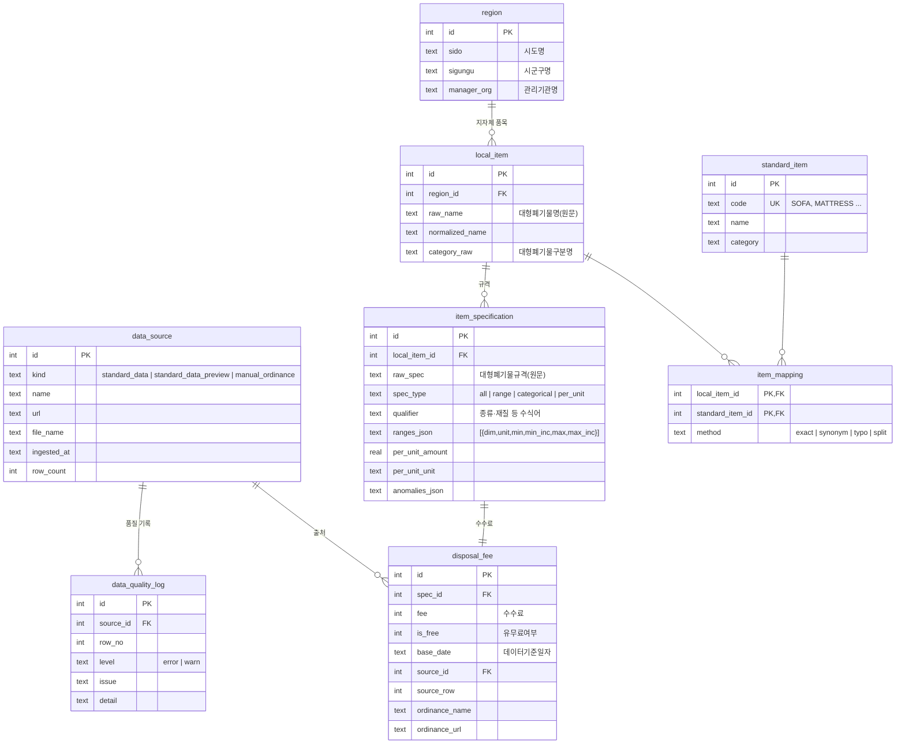

# 데이터베이스 ERD

## 설계 메모

- **원문 보존**: `raw_name`, `raw_spec`은 원본 그대로 저장하고 해석 결과(`normalized_name`, `ranges_json`)는 별도 컬럼에 둔다. 결과 화면에는 항상 원문 규격을 보여준다.
- **지역 품목 ↔ 표준 품목은 다대다**: 해운대구 `서랍장 신발장` 한 줄이 표준 품목 `서랍장`, `신발장` 둘 다에 연결된다. 반대로 부여군 `장식장`, `진열장`은 같은 표준 품목 하나에 연결되어 화면에서 먼저 어느 쪽인지 묻는다.
- **ItemSpecification 1 : DisposalFee 1**: 원본 한 행 = 규격 1개 + 수수료 1개. 같은 규격 문구에 수수료가 2개 있는 '충돌'은 행을 합치지 않고 그대로 두고, 엔진이 '확인 필요'로 처리한다.
- **질문 항목은 저장하지 않고 규격에서 계산**: 지시서의 `ItemSpecification(품목별 규격 및 질문 항목)`은 `ranges_json`·`qualifier`·`spec_type`으로 대체했다. 질문을 따로 저장하면 데이터 갱신 때 질문과 규격이 어긋날 수 있어서, 매 요청마다 그 지역의 실제 규격으로 질문을 만든다.
